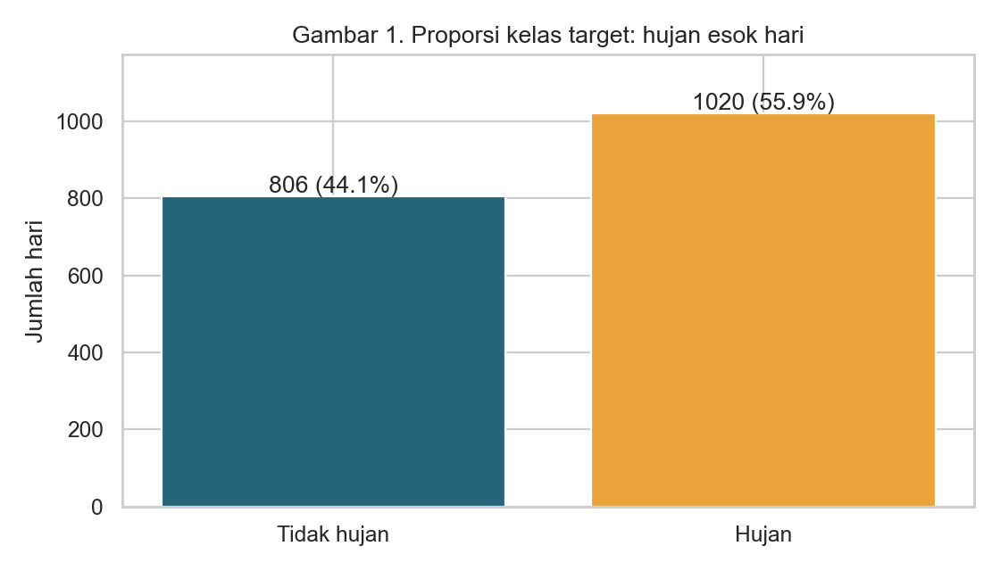
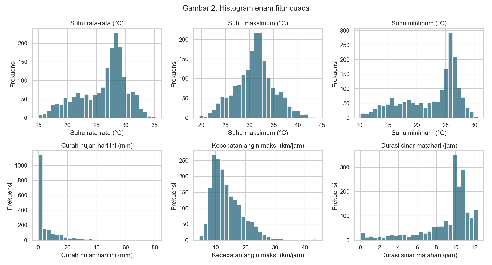
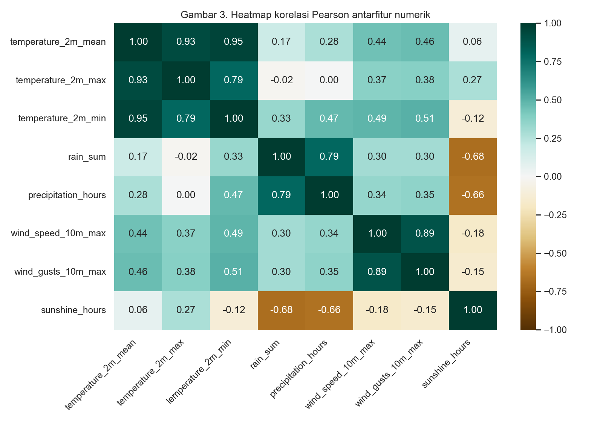
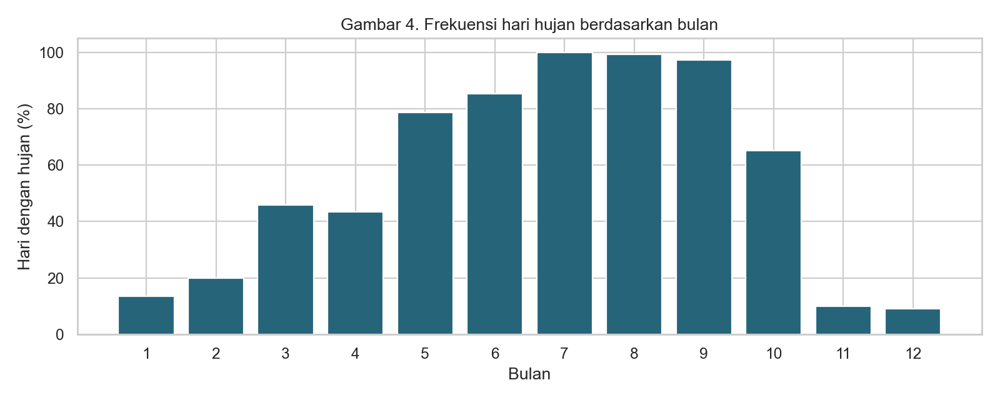
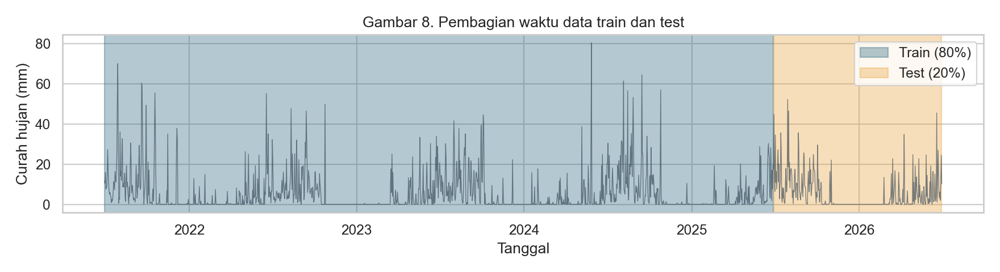
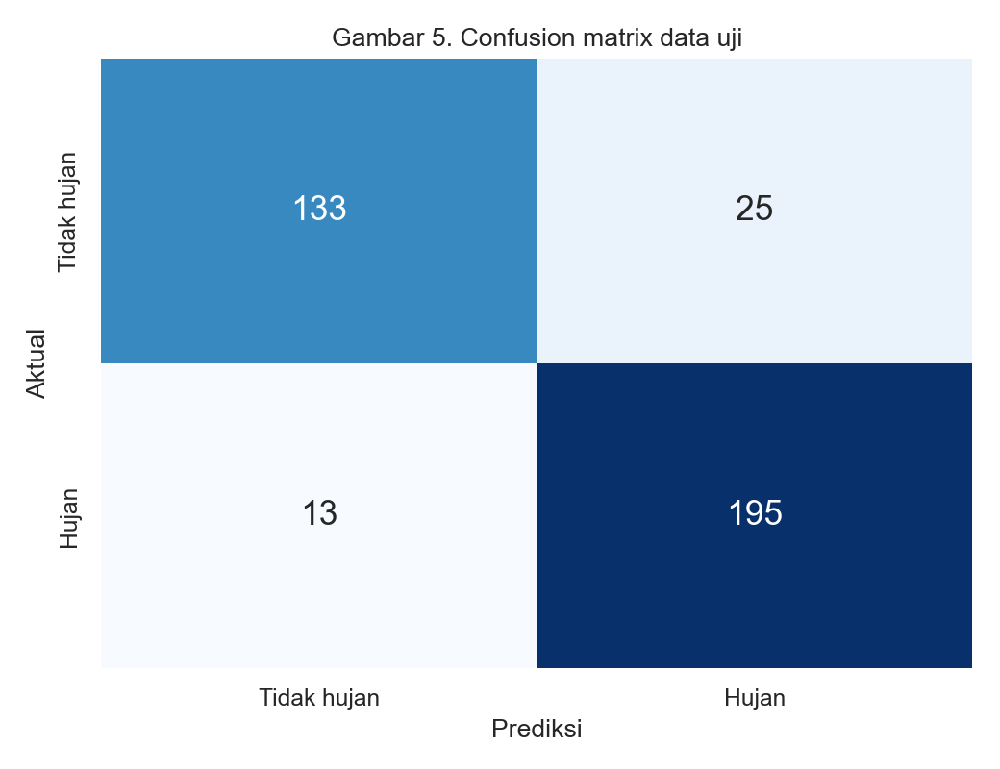
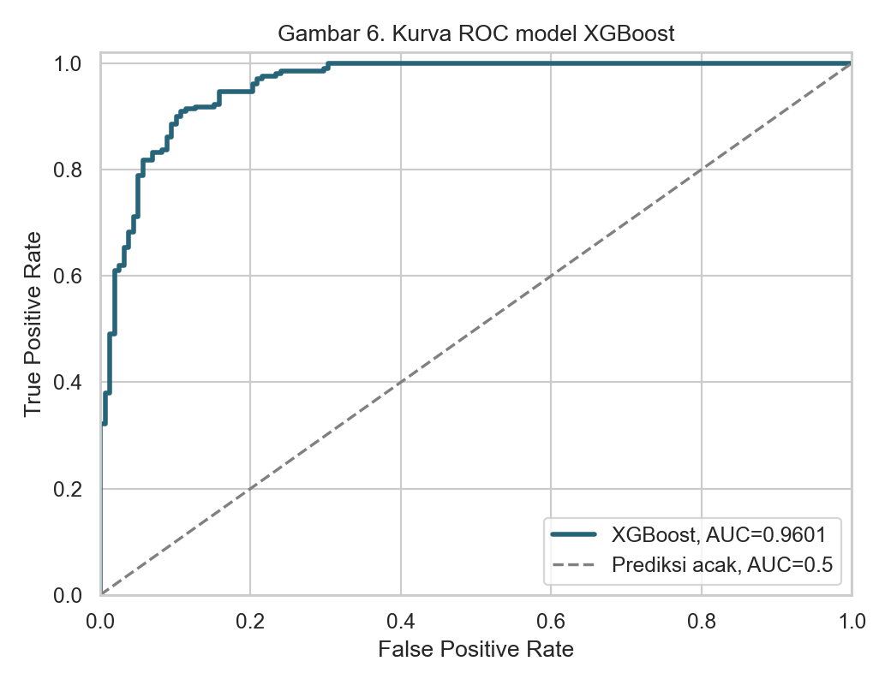
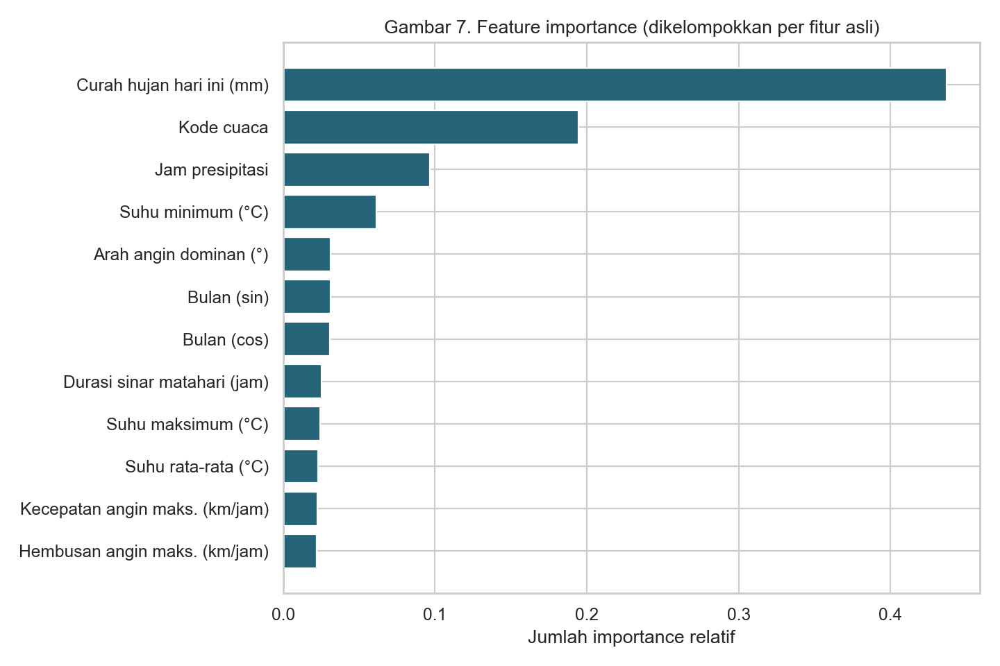

# HASIL VISUALISASI PRAKTIKUM XGBOOST

**Mochammad Maril Livio — NIM 231230065**

Delapan grafik berikut dihasilkan otomatis dari data CSV dan model XGBoost. Grafik dapat dilihat langsung di halaman GitHub ini setelah berkas diunggah.

## Gambar 1: Proporsi target

**Analisis:** Hujan (kelas 1) lebih banyak dibanding tidak hujan (kelas 0), tetapi distribusinya masih cukup seimbang untuk evaluasi. Persentase kelas dihitung pada 1.826 sampel valid.

## Gambar 2: Histogram fitur cuaca

**Analisis:** Histogram menunjukkan rentang, sebaran, dan kemencengan fitur. Curah hujan condong ke kanan karena banyak hari tanpa atau dengan hujan ringan, sementara nilai hujan ekstrem lebih jarang.

## Gambar 3: Korelasi fitur numerik

**Analisis:** Suhu maksimum dan suhu rata-rata berhubungan kuat. Curah hujan serta durasi presipitasi juga berkorelasi positif, tetapi korelasi bukan bukti hubungan sebab-akibat.

## Gambar 4: Pola hujan menurut bulan

**Analisis:** Proporsi hari hujan bervariasi sepanjang bulan. Visualisasi mendukung penggunaan fitur musiman sin/cos yang menjaga sifat siklis kalender.

## Gambar 5: Pemisahan data 80:20 berdasarkan waktu

**Analisis:** Bagian awal data dipakai train dan periode lebih baru dipakai test. Tidak mengacak urutan hari menghindari penggunaan data masa depan saat training.

## Gambar 6: Confusion matrix

**Analisis:** Sel kiri atas menunjukkan prediksi tidak hujan yang benar (TN), kanan atas alarm hujan palsu (FP), kiri bawah hujan terlewat (FN), dan kanan bawah hujan terdeteksi dengan tepat (TP).

## Gambar 7: ROC Curve

**Analisis:** Kurva ROC menampilkan sensitivitas berhadapan dengan tingkat positif palsu untuk beragam ambang. Nilai AUC yang jauh di atas 0,5 menunjukkan kemampuan diskriminasi baik.

## Gambar 8: Feature importance

**Analisis:** Grafik mengurutkan fitur yang banyak digunakan model. Curah hujan hari ini dan kode cuaca paling dominan, tetapi importance tidak bersifat kausal.

## Dashboard Interaktif

Kode Streamlit terdapat pada [`app.py`](app.py). Halaman Markdown ini menampilkan grafik statis di GitHub; untuk dashboard interaktif, jalankan Streamlit secara lokal atau deploy ke layanan hosting yang mendukung Streamlit.